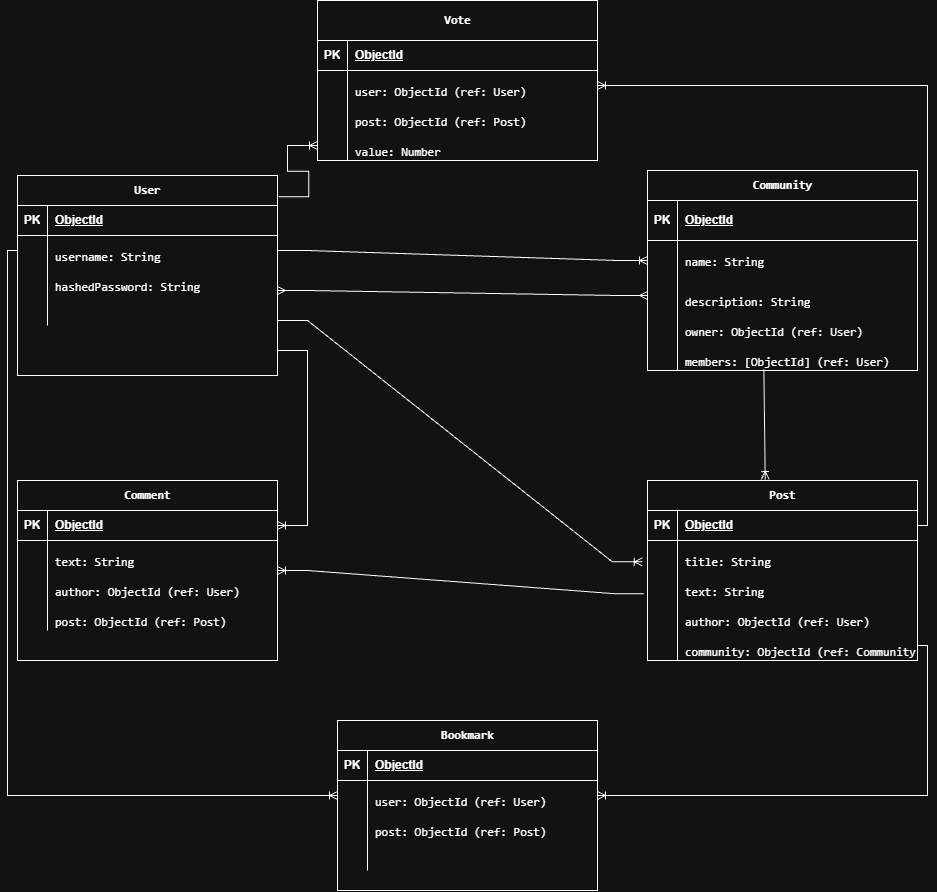

Threadly – Community Discussion Platform

## Overview
Threadly is a Reddit-style community discussion platform designed to help users connect, share ideas, and discuss different topics in one place.

The application allows users to create an account, securely sign in, browse communities, and join communities based on their interests. Users can create posts, view posts from other members, and interact through comments.

Users can also edit and delete their own posts and comments, upvote or downvote posts, and bookmark posts to view later. Visitors can browse communities, posts, and comments without signing in.

Threadly uses authentication and authorization to ensure users can securely manage their own content and interactions.

## Technologies Used

## Getting Started

## User Stories
User Stories

As a user, I want to create an account and log in.

As a user, I want to log out of my account.

As a user, I want to browse communities.

As a user, I want to create my own community.

As a user, I want to join and leave communities.

As a user, I want to view posts from different communities.

As a user, I want to create posts in communities I have joined.

As a user, I want to view the details of a post.

As a user, I want to edit my own posts.

As a user, I want to delete my own posts.

As a user, I want to add comments to posts.

As a user, I want to view comments on posts.

As a user, I want to edit my own comments.

As a user, I want to delete my own comments.

As a user, I want to upvote or downvote posts.

As a user, I want to remove or change my vote.

As a user, I want to bookmark posts.

As a user, I want to remove bookmarks.

As a user, I want to view my saved posts.

As a user, I want to browse posts without logging in.

## Database Design

## Routes

### Home Route

### Authentication Routes

### Client Routes

### Project Routes

## Features

## Future Enhancements

## Credits
