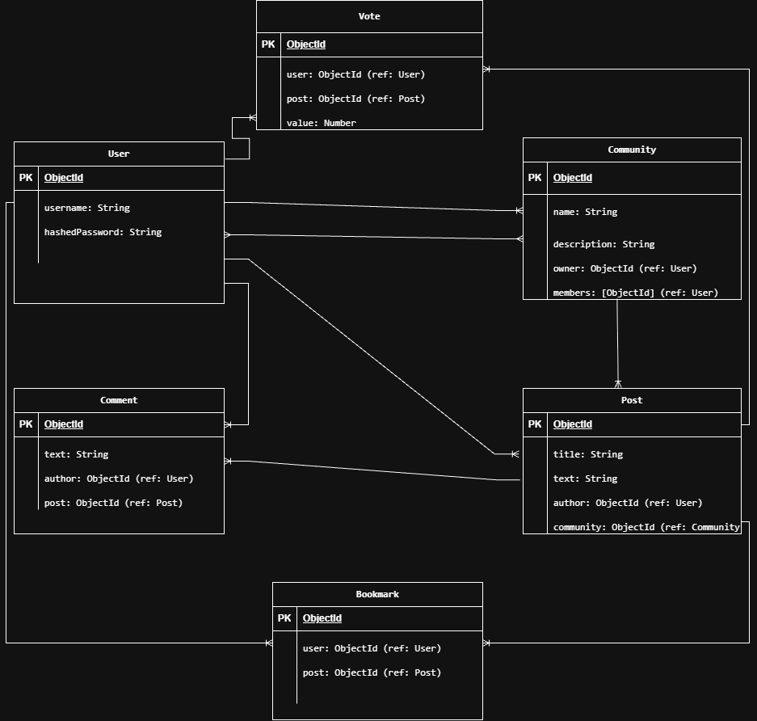

# Threadly - Community Discussion Platform Backend

## Overview

Threadly is a Reddit-style community discussion platform designed to help users connect, share ideas, and discuss different topics in one place.

The application allows users to create an account, sign in, create communities, and join communities based on their interests. Members can create posts, upload images, add comments, reply to other comments, and upvote or downvote posts. Users can also bookmark posts to read later.

This repository contains the backend REST API, built with Node.js, Express.js, MongoDB, and Mongoose. It handles authentication, community membership, content ownership, image uploads, and data storage. Visitors can browse communities, posts, comments, and vote totals without signing in.

The React application is available in the [Threadly frontend repository](https://github.com/Sayed-2003/threadly-frontend).

## Technologies Used

- JavaScript
- Node.js
- Express.js
- MongoDB
- Mongoose
- bcrypt
- JSON Web Tokens (jsonwebtoken)
- Multer
- CORS
- dotenv
- Morgan
- Nodemon

## Getting Started

To run the Threadly backend locally, you need Node.js 20.19.0 or later, npm, Git, and a local MongoDB server or MongoDB Atlas connection string.

1. Clone the repository:

   ```bash
   git clone https://github.com/Sayed-2003/threadly-backend.git
   ```

2. Go into the project folder:

   ```bash
   cd threadly-backend
   ```

3. Install the dependencies:

   ```bash
   npm install
   ```

4. Create a `.env` file in the root of the project and add:

   ```env
   MONGODB_URI=mongodb://127.0.0.1:27017/threadly
   JWT_SECRET=replace_with_your_own_long_random_secret
   PORT=3000
   CLIENT_URL=http://localhost:5173
   ```

   Use your MongoDB Atlas connection string instead of the local URI if needed. `JWT_SECRET` is used to sign and verify authentication tokens. `CLIENT_URL` should match the frontend's origin.

   The default port is `3000`, and the default frontend origin is `http://localhost:5173` if those variables are omitted. The `.env` file is ignored by Git.

5. Start the application in development mode:

   ```bash
   npm run dev
   ```

   To start it without Nodemon:

   ```bash
   npm start
   ```

6. Open the following URL in your browser or API client:

   ```text
   http://localhost:3000/communities
   ```

   This returns the active communities as JSON, or an empty array if none have been created.

7. Run the frontend separately to use the application interface, or use an API client to register, sign in, and test the routes below.

### Authentication

Send `username` and `password` as JSON to `/auth/sign-up` to create an account. Passwords must contain at least six characters.

Send the same credentials to `/auth/sign-in`. The response contains an `accessToken` and the user's details. Registration returns the new user's details; it does not return a token.

Include the token in the header of protected requests:

```http
Authorization: Bearer YOUR_ACCESS_TOKEN
```

Tokens expire after one hour. Signing out is handled by the frontend removing the stored token; there is no backend sign-out route.

### Image Uploads

Communities and posts support an optional image when creating or editing content.

- Use `multipart/form-data` and name the file field `image`.
- Supported image formats are JPG, PNG, and WebP.
- The maximum file size is 5 MB.
- Community creation and editing require `name` and `description`.
- Post creation requires `title`, `text`, and `community`, where `community` is the community ID.
- Post editing accepts `title`, `text`, or a new image; at least one must be provided.
- Uploading a new image when editing replaces the saved image URL. Omitting the image keeps the existing one.

Images are saved in the automatically created `uploads/` folder and served at `/uploads/:filename`. This folder is ignored by Git, so uploaded files are not included when someone clones the repository.

## User Stories

- As a visitor, I want to browse communities, posts, and comments without signing in.
- As a user, I want to create an account and sign in.
- As a user, I want to create a community with a name, description, and optional image.
- As a community owner, I want to edit or delete my community.
- As a user, I want to join and leave communities.
- As a community member, I want to create posts with text and an optional image.
- As a user, I want to view all posts or posts from one community.
- As a post author, I want to edit or delete my posts.
- As a community member, I want to comment on posts and reply to comments.
- As a comment author who belongs to the community, I want to edit or delete my comments.
- As a community member, I want to upvote or downvote posts and change or remove my vote.
- As a user, I want to bookmark posts, view my saved posts, and remove bookmarks.

## Database Design



The database contains six models:

| Model | Purpose |
|-------|---------|
| User | Stores usernames and hashed passwords |
| Community | Stores community information, an optional image URL, an owner, and members |
| Post | Stores a title, text, an optional image URL, an author, and a community |
| Comment | Stores comment text, an author, a post, and an optional parent comment for replies |
| Vote | Stores a user's upvote or downvote on a post |
| Bookmark | Stores a user's saved post |

All models include timestamps. Communities, posts, comments, votes, and bookmarks also use `isDeleted` and `deletedAt` for soft deletion.

## Routes

The default API base URL is `http://localhost:3000`. Public routes can be used without a token. All other access levels require a valid JWT.

### Authentication Routes

| Method | Route | Description | Access |
|--------|-------|-------------|--------|
| POST | `/auth/sign-up` | Create a new user account | Public |
| POST | `/auth/sign-in` | Sign in and receive an access token | Public |

### Community Routes

| Method | Route | Description | Access |
|--------|-------|-------------|--------|
| GET | `/communities` | Get all active communities | Public |
| GET | `/communities/:communityId` | Get one active community | Public |
| POST | `/communities` | Create a community and add its owner as a member | Signed-in user |
| PUT | `/communities/:communityId` | Edit a community and optionally replace its image | Community owner |
| DELETE | `/communities/:communityId` | Soft-delete a community and its related data | Community owner |
| PUT | `/communities/:communityId/membership` | Join a community | Signed-in user |
| DELETE | `/communities/:communityId/membership` | Leave a community | Community member |

### Post Routes

| Method | Route | Description | Access |
|--------|-------|-------------|--------|
| GET | `/posts` | Get all active posts in active communities | Public |
| GET | `/posts/community/:communityId` | Get posts from one community | Public |
| GET | `/posts/:postId` | Get one post and its vote totals | Public |
| POST | `/posts` | Create a post with an optional image | Community member |
| PUT | `/posts/:postId` | Edit a post and optionally replace its image | Post author |
| DELETE | `/posts/:postId` | Soft-delete a post | Post author |

### Comment Routes

| Method | Route | Description | Access |
|--------|-------|-------------|--------|
| GET | `/posts/:postId/comments` | Get a post's active comments, oldest first | Public |
| POST | `/posts/:postId/comments` | Add a comment or reply | Community member |
| PUT | `/posts/:postId/comments/:commentId` | Edit a comment | Comment author and community member |
| DELETE | `/posts/:postId/comments/:commentId` | Soft-delete a comment | Comment author and community member |

To add a comment, send `text`. To reply to another comment, also include its ID as `parentComment`. The parent comment must belong to the same post. Comments are returned as a flat array with parent references so the frontend can display replies.

### Vote Routes

| Method | Route | Description | Access |
|--------|-------|-------------|--------|
| GET | `/posts/:postId/votes` | Get upvote and downvote totals and the score | Public |
| GET | `/posts/:postId/my-vote` | Get the current user's vote, or `0` for no vote | Signed-in user |
| PUT | `/posts/:postId/vote` | Add, change, or restore a vote | Community member |
| DELETE | `/posts/:postId/vote` | Remove the current user's vote | Community member |

Send `{ "value": 1 }` for an upvote or `{ "value": -1 }` for a downvote. Each user can have one active vote per post. The score is the number of upvotes minus downvotes and can be negative.

### Bookmark Routes

| Method | Route | Description | Access |
|--------|-------|-------------|--------|
| GET | `/bookmarks` | Get the current user's saved posts, newest first | Signed-in user |
| POST | `/bookmarks/:postId` | Save a post or restore a removed bookmark | Signed-in user |
| DELETE | `/bookmarks/:postId` | Remove a saved post | Bookmark owner |

Community membership is not required to bookmark a post. Saved posts from deleted posts or communities are excluded from the bookmark list.

### Uploaded Images

| Method | Route | Description | Access |
|--------|-------|-------------|--------|
| GET | `/uploads/:filename` | View an uploaded image | Public |

## Features

- User registration and sign-in
- Password hashing with bcrypt
- JWT authentication and ownership checks
- Public browsing of communities, posts, comments, and vote totals
- Community creation, editing, and deletion
- Community membership with join and leave actions
- Post creation, editing, and deletion
- Optional image uploads and image replacement for communities and posts
- Comments and replies with author-only editing and deletion
- Upvotes, downvotes, vote changes, and vote removal
- Personal bookmarks with save, remove, and restore actions
- Soft deletion of communities, posts, comments, votes, and bookmarks
- Community deletion also soft-deletes its posts, comments, votes, and bookmarks
- MongoDB relationships between users, communities, posts, and interactions

## Future Enhancements

- API search and filtering for communities and posts
- Pagination for larger post and comment lists
- Notifications for replies and community activity
- Community moderation tools
- Cloud storage for uploaded images
- Password reset and email verification

## Credits

- Developed by Ammar Mohamed Khamis, Sayed Baqer, and Ali Kamel.
- Built as part of the General Assembly Software Engineering Bootcamp.
- Inspired by Reddit-style communities and discussions.
- Special thanks to Omar for his help and support throughout the project.